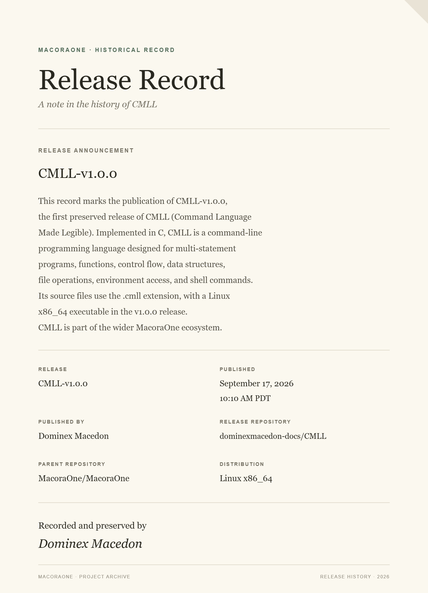
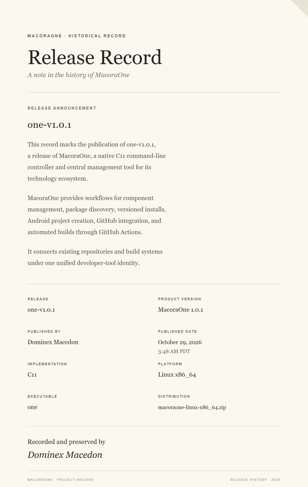
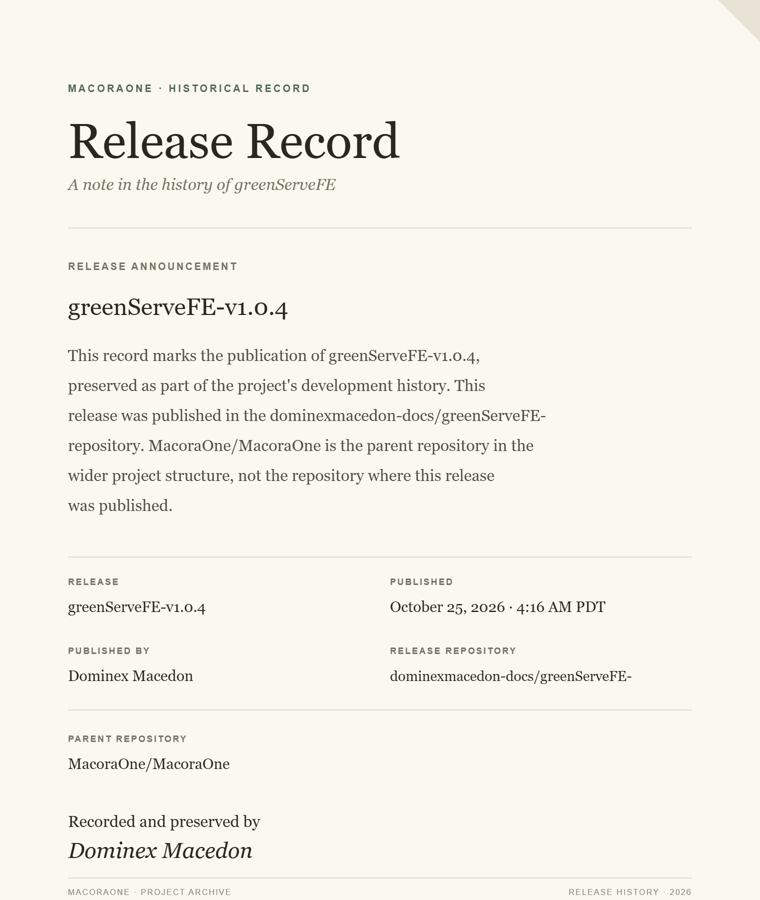

# MacoraOne Records

**MacoraOne Records** is the historical archive of software releases, version milestones, and preserved release records from the MacoraOne technology ecosystem, created by **Dominex Macedon**.

This repository documents the publication history of projects in the ecosystem through visual release records. Each record preserves a project's name, release version, publication details, and other identifying information as an archival reference.

## Release Records

### CMLL - Version 1.0.0

The historical release record for **CMLL 1.0.0**, a release in the MacoraOne technology ecosystem.

[View the CMLL 1.0.0 release record image](CMLL/CMLL-v1.0.0-record.png)

### MacoraOne — Version 1.0.1

The historical release record for **MacoraOne 1.0.1**, the native C11 command-line controller and management tool for the MacoraOne technology ecosystem.

Published: **October 29, 2026 · 3:48 AM PDT**

[View the MacoraOne 1.0.1 release record image](MacoraOne/MacoraOne-v1.0.1-record.png)

### greenServeFE — Version 1.0.4

The historical release record for **greenServeFE 1.0.4**, a VM-based programming language and development environment in the MacoraOne ecosystem.

[View the greenServeFE 1.0.4 release record image](greenServeFE/greenServeFE-v1.0.4-record.png)

## About This Archive

MacoraOne Records serves as a central, browsable archive for release documentation across the ecosystem. It provides a visual reference for published software versions and helps preserve project history independently of individual source-code changes.

The archive may include:

- Software release records and version milestones
- Publication dates and release identification details
- Historical images documenting individual releases
- Records for programming languages, command-line tools, virtual machines, and developer utilities

## Projects and Source Repositories

The records are archival references. For source code, implementation details, installation instructions, and current project information, visit the corresponding project repositories.

- **MacoraOne:** [github.com/MacoraOne/MacoraOne](https://github.com/MacoraOne/MacoraOne)
- **CMLL:** [github.com/dominexmacedon-docs/CMLL](https://github.com/dominexmacedon-docs/CMLL)
- **greenServeFE:** [github.com/dominexmacedon-docs/greenServeFE-build](https://github.com/dominexmacedon-docs/greenServeFE-build)

## Archive Maintainer

**Dominex Macedon**

MacoraOne technology ecosystem

---

*MacoraOne Records - a historical archive of software releases, projects, and version milestones.*
